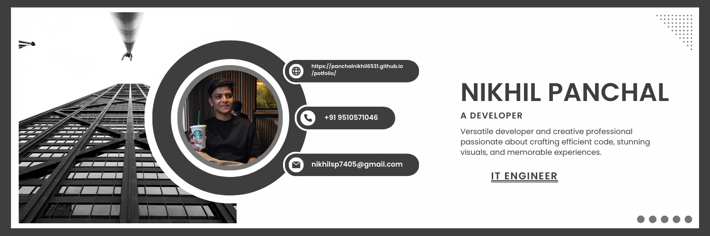

  

<h1 align="center">Panchal Nikhil S</h1>
<h3 align="center">Full Stack Developer · B.Tech Information Technology</h3>

  

  
  
  
  

  
  
  

---

## About Me

I'm a **Full Stack Developer** and **B.Tech IT student** based in **Ahmedabad, India**. I design and build end-to-end web applications — from clean, responsive user interfaces to secure RESTful backends backed by MongoDB.

I care about writing maintainable code, shipping products that people actually use, and bringing a designer's eye (from my background in video and photo editing) to every interface I build.

- **Currently focused on:** Advanced JavaScript, React, and UI/UX design
- **Exploring:** Cross-platform mobile development with Flutter & Dart
- **Career goal:** Frontend / Full Stack Software Engineer
- **Open to:** Internships, freelance projects, and open-source collaboration

---

## What I Do

| Area | Capabilities |
|---|---|
| **Frontend** | Responsive, accessible UIs with HTML5, CSS3, JavaScript and React |
| **Backend** | REST APIs with Node.js & Express, JWT authentication, middleware, routing |
| **Database** | MongoDB data modelling with Mongoose |
| **Mobile** | Cross-platform apps with Flutter & Dart |
| **Design** | UI layouts, visual assets, and video/photo editing (Canva and editing tools) |

---

## Tech Stack

**Languages**

  

**Frontend**

  

**Backend & Database**

  

**Mobile, Tools & Platforms**

  

---

## Featured Projects

| Project | Description | Tech | Links |
|---|---|---|---|
| **Developer Portfolio** | Responsive personal portfolio showcasing skills, projects, certifications and experience | HTML · CSS · JavaScript | [Live](https://potfolio-beta-two.vercel.app/) · [Code](https://github.com/panchalnikhil6531/potfolio) |
| **JS Info Tracker** | Full stack learning-progress tracker for javascript.info with user accounts, authentication and a community leaderboard | Node.js · Express · MongoDB | [Live](https://jsinfo-tracker.onrender.com/) · [Code](https://github.com/panchalnikhil6531/jsinfo-tracker) |
| **Intern Logbook** | Daily work log for interns — record what you did each day and see what everyone else has done | JavaScript · Cloudflare Workers | [Live](https://intern-logbook.nikhilsp7405.workers.dev/) · [Code](https://github.com/panchalnikhil6531/logs) |
| **ClipFetch** | Paste a link and save videos in seconds — a fast, minimal video downloader | JavaScript · Cloudflare Workers | [Live](https://clipfetch.nikhilsp7405.workers.dev/) |
| **QR Code Generator** | Free QR code generator — create QR codes instantly, no sign-up required | JavaScript · Cloudflare Workers | [Live](https://qr-code-generator.nikhilsp7405.workers.dev/) |
| **US Life** | Full stack web app with a Node.js/Express REST API, secure authentication and MongoDB | Node.js · Express · MongoDB | [Live](https://intenship-training.vercel.app/) · [Code](https://github.com/panchalnikhil6531/intenship-training) |
| **Office Manager** | Cross-platform application for managing day-to-day office operations | Flutter · Dart | [Code](https://github.com/panchalnikhil6531/Office-Manager) |
| **Python Projects** | A collection of Python programs and mini-projects for learning and reference | Python | [Code](https://github.com/panchalnikhil6531/my-python-projects) |

---|---|---|
| [**JS Info Tracker**](https://github.com/panchalnikhil6531/jsinfo-tracker) | Full stack learning-progress tracker for javascript.info with user accounts, authentication and a community leaderboard | Node.js · Express · MongoDB · JS |
| [**Backend API**](https://github.com/panchalnikhil6531/intenship-training) | RESTful backend providing secure authentication, database management and API services for web applications | Node.js · Express · MongoDB |
| [**Office Manager**](https://github.com/panchalnikhil6531/Office-Manager) | Cross-platform application for managing day-to-day office operations | Flutter · Dart |
| [**Developer Portfolio**](https://github.com/panchalnikhil6531/potfolio) | Responsive personal portfolio showcasing skills, projects, certifications and experience — [live](https://potfolio-beta-two.vercel.app/) | HTML · CSS · JavaScript |
| [**US-AIRPODS.IN**](https://github.com/panchalnikhil6531/US-AIRPODS.IN) | E-commerce style product website for AirPods and wireless devices | HTML · CSS |
| [**Python Projects**](https://github.com/panchalnikhil6531/my-python-projects) | A collection of Python programs and mini-projects for learning and reference | Python |

---

## GitHub Analytics

  
  

  

  

---

## Get In Touch

I'm always happy to discuss new opportunities, projects, or ideas.

- **Email:** [nikhilsp7405@gmail.com](mailto:nikhilsp7405@gmail.com)
- **LinkedIn:** [nikhil-s-panchal](https://www.linkedin.com/in/nikhil-s-panchal-463a78319/)
- **Portfolio:** [potfolio-beta-two.vercel.app](https://potfolio-beta-two.vercel.app/)

<i>If you find my work useful, consider giving a repository a ⭐</i>

